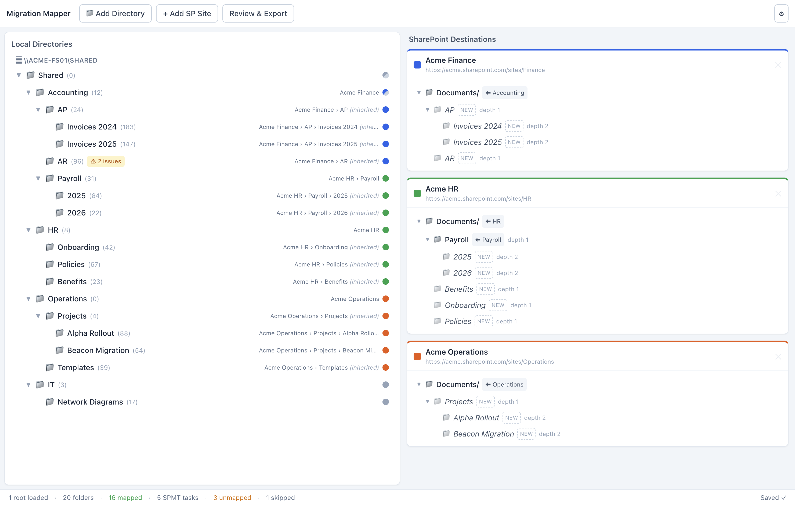
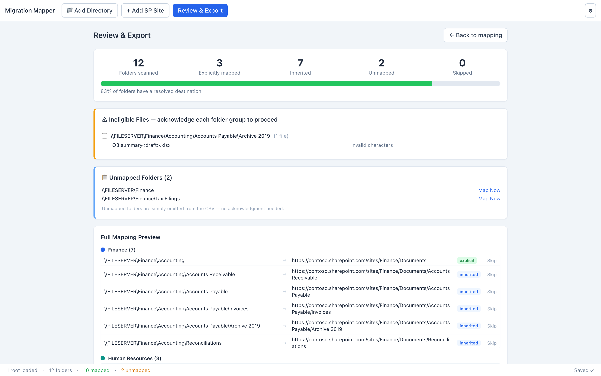

<div align="center">

# 🗂️ Migration Mapper

**Plan and map file-share → SharePoint Online migrations, visually.**

Point it at a local or network folder tree, drag folders onto SharePoint sites, and export a [SharePoint Migration Tool](https://learn.microsoft.com/sharepointmigration/introducing-the-sharepoint-migration-tool)–ready CSV — with built-in guardrails for SharePoint's path-length, folder-depth, and naming limits, so migrations don't fail halfway through.

[](https://github.com/NeverNathaniel/SPMM/actions/workflows/desktop-build.yml)
[](https://github.com/NeverNathaniel/SPMM/releases/latest)




</div>

---

## The problem

Migrating a Windows file share to SharePoint Online with Microsoft's **SharePoint Migration Tool (SPMT)** means handing it a CSV of migration tasks — each row a source folder that SPMT copies *recursively* to a destination URL. Building that CSV by hand is tedious and error-prone — and SPMT will happily start a migration that breaks partway through because a path exceeded 400 characters, a folder nested too deep, or a filename contained characters SharePoint rejects.

**Migration Mapper turns that into a visual, validated workflow:**

- **See** the source tree and the resulting destination structure side by side.
- **Map** folders by dragging — map a parent once and every child follows.
- **Catch** SharePoint limit violations *before* you migrate, not during.
- **Export** a CSV that SPMT consumes directly, plus a human-readable summary.

It's built to be deployed by a technician and handed to the people who actually know the file share: they do the mapping, the technician retrieves the export and runs SPMT. No one has to touch SPMT's CSV format by hand.

## Features

- 🗺️ **Drag-and-drop mapping** — scan a local or UNC path, then drag source folders onto SharePoint sites and the folders within them.
- 🌳 **Map once, inheritance flows** — map a parent folder and every unmapped descendant inherits its destination proportionally. Override any branch by mapping it explicitly; unmapping cascades cleanly.
- 👁️ **Live destination preview** — each SharePoint site card shows exactly how folders will nest under `Documents/` as you map: mapped folders appear as source chips, inherited children render as read-only `NEW` rows, and same-named folders merge the way SharePoint actually merges them.
- 🛡️ **Guardrails before you migrate** — configurable folder-depth and worst-case URL-length thresholds (warn / hard-block), surfaced inline as you map.
- 🚫 **Ineligible-name detection** — flags files and folders whose names SharePoint won't accept (invalid characters, reserved names, leading/trailing dots, temp/lock files) at scan time.
- 📤 **SPMT-ready export** — a headerless CSV that SPMT reads directly, with one row — one independent, fully recursive migration task — per maximal uniformly-mapped subtree, plus a self-contained HTML summary for sign-off.
- 💾 **Resumable sessions** — work auto-saves (with a final flush on window close) and survives restarts; pick up exactly where you left off. A single-instance lock stops a second copy from clobbering the session.
- 🔧 **Technician configuration** — pre-seed sites, set the tenant domain and thresholds, and optionally PIN-protect settings via a deployable `tech-config.json`.

## Screenshots

### Mapping view

Source tree on the left, SharePoint destinations on the right. Mapping `Accounting` once cascades to its children (shown *inherited*); the destination cards update live to show the structure each migration will produce.


### Review & export

A pre-flight summary: what's mapped, inherited, unmapped, and skipped; ineligible files to acknowledge; and the full resolved source → SharePoint-URL preview before the CSV and HTML summary are written.



*This screenshot predates the v0.2 export rework — current builds additionally show the SPMT task count, `/Shared Documents/` destination URLs, and the split-folder / conflict / tenant-domain gating sections.*

## How it works

### The mapping model

Mappings follow a small set of rules so behaviour is predictable on large trees:

1. **Explicit wins** — a folder you map directly always uses that destination.
2. **Children inherit** — unmapped descendants of a mapped folder inherit proportionally (`AP/Invoices` under a mapped `AP` lands at `…/AP/Invoices`).
3. **Explicit breaks the chain** — mapping a child explicitly redirects only its own subtree.
4. **Remap replaces** — dropping a mapped folder somewhere new replaces its destination, after a confirmation.
5. **Unmap cascades** — removing a mapping removes everything that inherited from it, while explicitly-mapped branches survive.
6. **Files follow folders** — there are no file-level mappings.
7. **Paths are preserved verbatim** — UNC (`\\server\share`) and local (`C:\…`) source paths are written to the CSV exactly as scanned.

**Skipping** a folder (on the review screen) excludes the whole branch: children stop inheriting, and the branch is carved out of its parent's migration. An explicitly re-mapped descendant of a skipped folder still migrates — to its own destination.

Inherited mappings are **derived, never stored** — only your explicit mappings persist, and inheritance is recomputed on every change and on session load, so stale chains are impossible.

### The export

Each row in an SPMT CSV is an independent, **fully recursive** migration task — SPMT copies everything under the source path, and the format offers no per-folder exclusions (and no header row: SPMT reads every line as a task). So rather than one row per resolved folder, the export plans **one task per maximal uniformly-mapped subtree** — the largest folders whose entire subtree lands exactly where a single recursive copy would put it. Around an exception — a skipped folder, or a subtree explicitly re-mapped elsewhere — the parent is split into per-child tasks instead. A split parent's *direct files* are then not covered by any task, so they're surfaced as an acknowledge-to-proceed warning on the Review screen and in the HTML report.

### Guardrails

| Check | Default | Behaviour |
|---|---|---|
| Destination folder depth (relative to `Documents/`) | warn at 2, block at 3 | Blocked folders can't receive mappings |
| Worst-case destination URL length | warn above 256, block above 400 | Uses the longest filename captured at scan time. 257–400 is acknowledge-to-proceed; over 400 is a hard block — SPMT is guaranteed to fail |
| Tenant domain | — | Export is blocked until the domain is a real host: the `contoso.sharepoint.com` placeholder or a malformed value blocks export |
| Ineligible file / folder names | always on | Flagged at scan; invalid mapped folder names block export |

Depth blocks, over-limit URLs, invalid mapped-folder names, source conflicts from overlapping roots, and a placeholder/malformed tenant domain are hard blocks; amber URL-length warnings, ineligible files, and split-parent direct files are *acknowledge-to-proceed* on the review screen. Destination URLs — and the URL-length math — use the Documents library's real `/Shared Documents/` URL segment, so what you see is what SharePoint's limit actually measures. Thresholds are configurable in `tech-config.json`.

## Tech stack

| Layer | Choice |
|---|---|
| Shell | **Electron** (main process + context-isolated preload bridge) |
| UI | **React 18 + TypeScript**, **Tailwind CSS**, **@dnd-kit** for drag-and-drop |
| State | **Zustand** with derived-state selectors and debounced autosave |
| Build / tooling | **Vite** (+ `vite-plugin-electron`), **Vitest**, **electron-builder** |
| Scanning | Node `fs` in a **worker thread**, behind IPC, with throttled progress |

### Architecture notes

The design keeps a clean boundary between platform code and logic:

- **Pure-logic core** lives in `src/shared/` with **no Node or DOM imports** — the mapping engine, validation, ineligible-name classification, the SPMT task planner and CSV generator, the HTML report, and the live-preview merge. It's all unit-tested in isolation.
- **The renderer touches the OS only through the preload bridge** (`contextIsolation: true`, `nodeIntegration: false`); directory scanning runs in a worker thread so the window stays responsive on large shares.
- **Single source of truth** — explicit mappings are the only persisted state; everything else (inheritance, validation, the destination preview) is derived.

## Getting started

**Prerequisites:** Node `^20.19.0 || >=22.12.0` (Vite 8's requirement). Packaging Windows installers requires running `npm run dist` on Windows; development works on any platform.

```bash
git clone https://github.com/NeverNathaniel/SPMM.git
cd SPMM
npm install

npm run dev      # Vite dev server + Electron with hot reload
npm test         # Vitest unit tests (mapping engine, validation, CSV, scanner…)
npm run build    # type-check (tsc --noEmit) + production bundles
npm run dist     # build + package the Windows installer & portable exe (release/)
```

Prefer not to build it yourself? Grab the installer or portable executable from the [latest release](https://github.com/NeverNathaniel/SPMM/releases/latest).

> `npm run dev` / `dist` need the Electron binary. In headless or CI environments it's commonly skipped with `ELECTRON_SKIP_BINARY_DOWNLOAD=1`; reinstall `electron` with network access before running the GUI.

## Usage

1. **Add a directory** — scan a local folder or UNC share. The tree appears on the left with file counts and any ineligible-name flags. Long scans can be cancelled mid-flight; each root can be rescanned in place (mappings for folders that still exist are kept); a root that overlaps an already-loaded one is refused.
2. **Add a SharePoint site** — give it a name; the `/sites/` slug is generated for you (editable). Create folders under `Documents/` as needed.
3. **Map** — drag a source folder onto a destination folder (or `Documents/` itself). Children inherit automatically; the destination card previews the result live.
4. **Review** — open **Review & Export** to see the summary, resolve or acknowledge any flagged folders, and check the full source → URL preview.
5. **Export** — write the SPMT CSV and HTML summary. Hand the CSV to SPMT to run the migration.

## Project structure

```
electron/            main process: window, IPC, scan worker, persistence, export
  main.ts            BrowserWindow + IPC handlers
  preload.ts         contextBridge API (the renderer's only OS surface)
  scanDir.ts         core directory walk (testable, shared with the worker)
  scanWorker.ts      worker_threads wrapper with throttled progress
  store.ts           atomic JSON read/write (temp file + rename)
src/
  shared/            pure logic — no Node/DOM imports, fully unit-tested
    types.ts         data model (FolderNode, SharePointSite, ExplicitMapping…)
    classify.ts      ineligible file/folder detection + hidden/system filtering
    mappingEngine.ts the mapping rules; inherited mappings always derived
    spFolders.ts     immutable SharePoint folder-tree operations
    sitePreview.ts   merged live preview of a site's structure under Documents/
    spmtPlan.ts      SPMT recursive-task planning — maximal uniform subtrees,
                     split-file warnings, overlapping-root conflicts
    review.ts        export gating (hard blocks, acknowledgments)
    csv.ts           SPMT CSV generation
    htmlReport.ts    self-contained HTML summary
    techConfig.ts    tech-config sanitisation
  store/             Zustand store + derived-state hooks (debounced autosave)
  components/        screens and panels (mapping view, review, settings)
tests/               Vitest suites for src/shared, the Zustand store, and scanDir
```

## Testing

```bash
npm test
```

All logic is headless-testable — no Electron binary or display required. The Vitest suites cover the seven mapping rules, SPMT task planning (maximal uniform subtrees, split-file warnings, overlapping-root conflicts), review/export gating, depth/path-length validation, ineligible-name classification, the SharePoint folder-tree operations, the live-preview merge, SPMT CSV generation, the HTML report, tech-config sanitisation, the Zustand store's behaviour, and the directory scanner.

## Configuration

Deployments are configured through `tech-config.json`, loaded in layers: built-in defaults, overlaid by a **deployment seed** a technician ships with the app — next to the executable (for the portable exe that's the directory containing the `.exe`, via `PORTABLE_EXECUTABLE_DIR`) or in `resources/` — overlaid in turn by settings saved in-app, which go to `%APPDATA%\MigrationMapper\tech-config.json`. Every layer is sanitised on load: unknown keys are dropped, wrongly-typed values fall back to defaults, and warn thresholds are clamped strictly below their block thresholds.

| Field | Type | Default | Description |
|---|---|---|---|
| `tenantDomain` | string | `contoso.sharepoint.com` (placeholder) | SharePoint tenant host. Export is blocked until it's set to a real host. |
| `tenantLocked` | boolean | `false` | Lock the tenant domain for end users (they get a "Request Change" mail link instead). |
| `supportEmail` | string | `""` | Address the "Request Change" link mails. |
| `preSeededSites` | `{name, slug?}[]` | `[]` | Sites created on first launch. |
| `quickAddPresets` | string[] | `HR, Accounting, Operations, IT, Legal, Finance` | One-click site-name suggestions. |
| `allowUserAddSites` | boolean | `true` | Whether end users can add sites themselves. |
| `exportPathOverride` | string | `""` | Absolute directory for exports (default: a per-user app-data `exports/` folder). |
| `sessionBehavior` | `accumulate` \| `clear-on-load` | `accumulate` | Keep previously scanned roots when adding new ones, or not. |
| `depthWarnAt` / `depthBlockAt` | number | `2` / `3` | Destination folder-depth thresholds, relative to `Documents/`. |
| `pathWarnAt` / `pathBlockAt` | number | `256` / `400` | Worst-case destination-URL-length thresholds. |
| `settingsPin` | string | `""` | Optional PIN protecting the settings screen. Verified in the main process — never exposed to the UI. |
| `operatorNote` | string | `""` | Free-text note included in the HTML summary header. |

## Notes

- Installers are produced unsigned; code signing can be layered into the packaging step.
- Windows is the packaged target today; the renderer and core logic are platform-agnostic.

## License

[MIT](LICENSE) © 2026 Nathan Sol.
